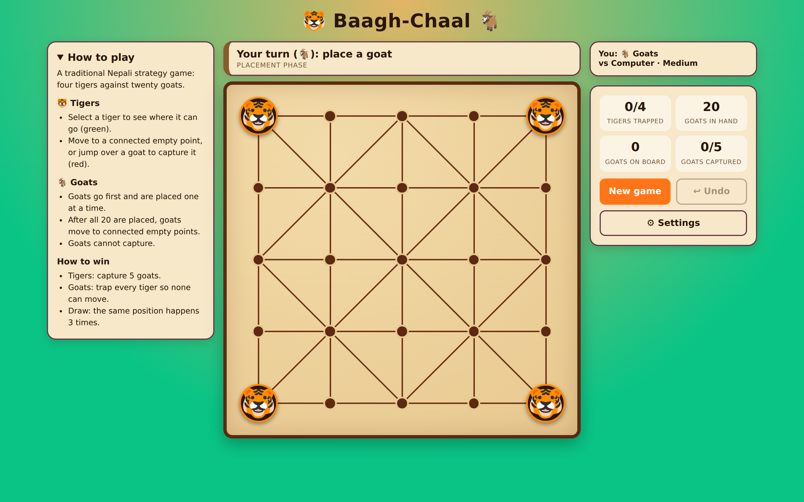
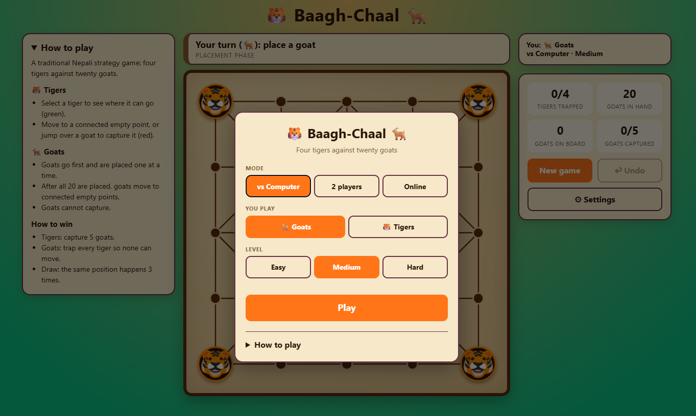
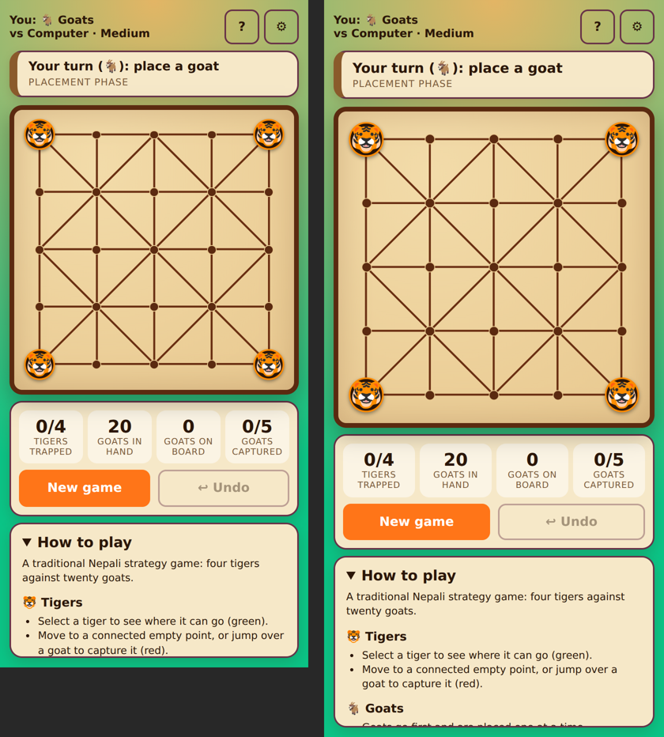
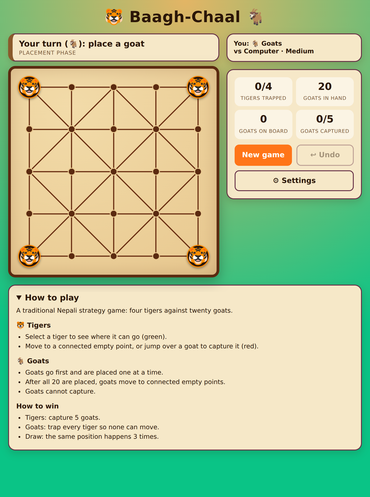

# Baagh-Chaal

A Nepali strategy game with local two-player play, and a computer opponent.

## Run

Open index.html in a browser.

## Screens

The game opens on a **start screen** (every time) where you pick the mode (vs Computer, 2 players, Online), the side you play
and the computer's level. Your last choices are already selected, so it's one tap on **Play**. While playing, the screen shows a one-line summary, the board, the counters and the New game / Undo buttons.
On wide screens there are three panels: **How to play** on the left, the board in the middle, and the summary + counters + buttons
(including **Settings**, which reopens the start screen) on the right. On phones the summary is a bar above the board (with **?** for the
rules and **⚙** for settings), the whole game fits on one screen, and the **How to play** panel uses whatever space is left under it.
The browser's Back button also returns to the start screen.

## Online play (no server needed)

Choose **Online (friend)** in the Mode dropdown.

1. One player clicks **Create game** and shares the 5-character code (or **Copy invite link**).
2. The other player types the code and clicks **Join**, or just opens the invite link.

How it works: the two browsers connect directly to each other with [PeerJS](https://peerjs.com) (WebRTC); a free public
matchmaking server is used only for the first handshake, so the game can be hosted as plain static files (e.g. GitHub Pages).
Only moves are sent (`{from, to}`), and each browser checks every move with its own `js/rules.js`.

Notes: some strict networks (corporate firewalls, some mobile data) can block direct connections. The connection code is in
`js/net.js`; PeerJS 1.5.5 (MIT) is bundled in `js/vendor/`. The files `.env.example` and `.gitignore` entries about Turso are
left over from the earlier socket.io server attempt and are not used.

Tests: none are included in the repo yet.

